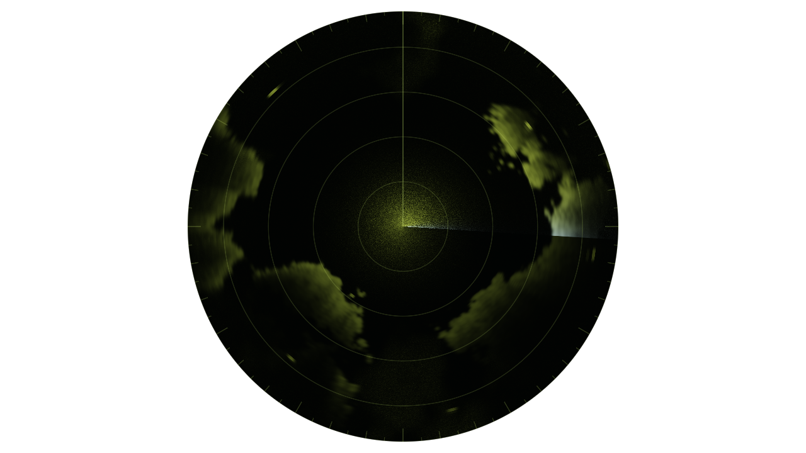
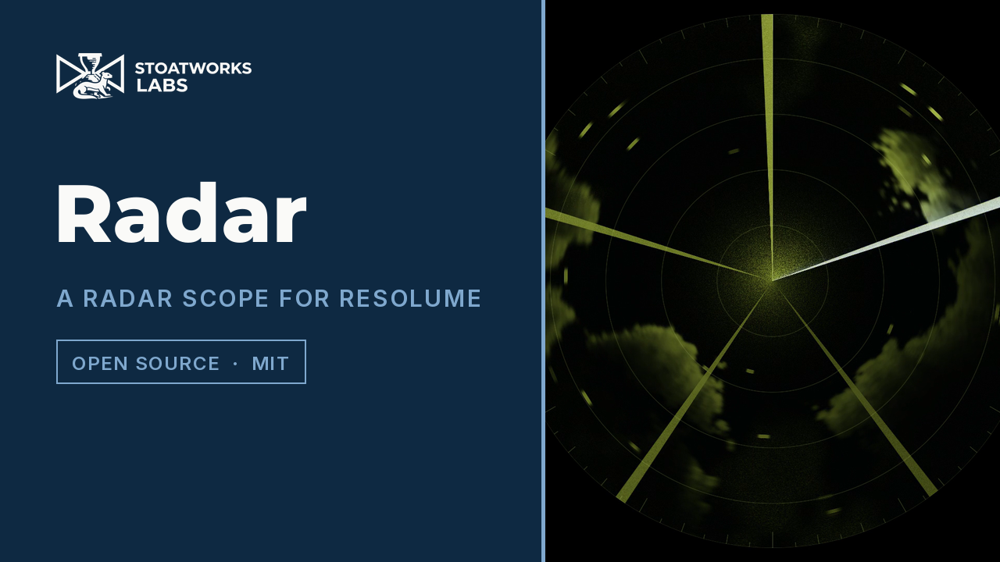
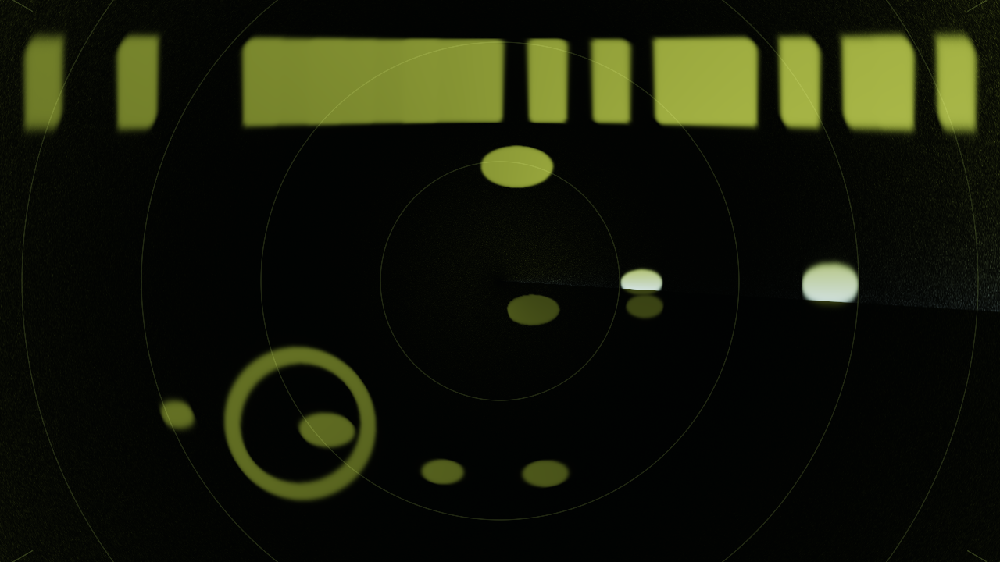
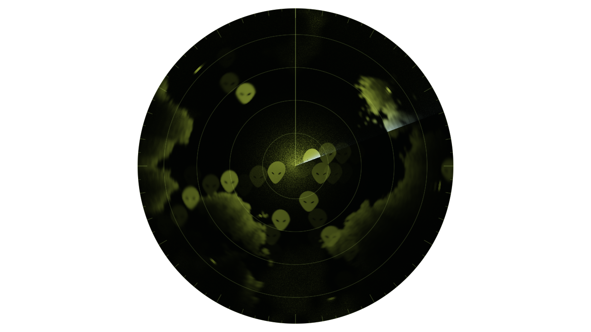
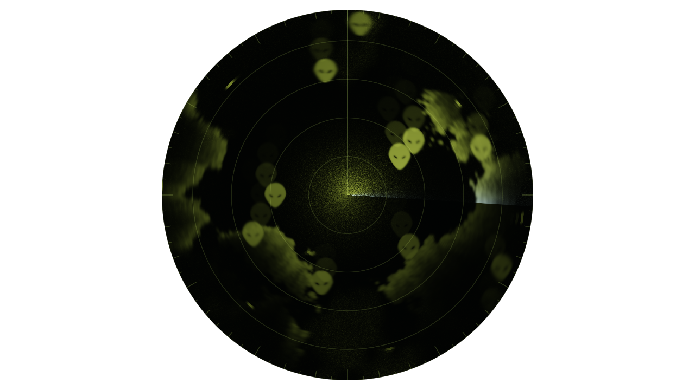

# radar

> **AI-assisted project.** This codebase was created with [Claude](https://claude.com/claude-code)
> (Anthropic), directed and reviewed by a human author. It's **never been loaded into
> Resolume on macOS**, where the only host it's met is [oxbow](https://github.com/stoatworks-labs/oxbow),
> a real FFGL host that isn't Resolume. On Windows both plugins pass the fleet's Arena gate in
> Resolume Arena 7.27.1 on software rendering, sprites included, at v0.2.0. Everything else is measured by an offline
> harness that drives the real plugin classes in a headless GL context, on this Mac's GPU at
> two rasters and again on Apple's software renderer, and every check is also run against a
> wrong model to make sure it can fail. The numbers, and what I haven't tried yet, are under
> [Status](#status).

A plan-position radar scope for Resolume Arena and Avenue, the round, glowing kind every
war film cuts to when things get tense. It comes as two FFGL plugins: **SW Radar**, a
source that's a radar watching a synthetic sea, and **SW Radar Over**, an effect that
makes your clip the sea.

The source's defaults after ten seconds: a bay open to the north on a 24 km
scope, the sweep just past east with the trail fading behind it. Rendered by the
plugin's offline harness (`ratest`) rather than captured from Resolume.

<!-- downloads:start -->

## Download

**[v0.2.0](https://github.com/stoatworks-labs/radar/releases/tag/v0.2.0)** — prebuilt for macOS and Windows. Pick your platform:

<b>macOS</b> — Universal (Apple Silicon + Intel)

| Build | Download | Size |
| --- | --- | --- |
| Universal (Apple Silicon + Intel) · .dmg disk image | [`radar-0.2.0-macos-universal.dmg`](https://github.com/stoatworks-labs/radar/releases/download/v0.2.0/radar-0.2.0-macos-universal.dmg) | 760 KB |
| Universal (Apple Silicon + Intel) · .zip archive | [`radar-macos-universal.zip`](https://github.com/stoatworks-labs/radar/releases/latest/download/radar-macos-universal.zip) | 686 KB |

<b>Windows</b> — x64

| Build | Download | Size |
| --- | --- | --- |
| x64 · .exe installer | [`radar-0.2.0-windows-x86_64-setup.exe`](https://github.com/stoatworks-labs/radar/releases/download/v0.2.0/radar-0.2.0-windows-x86_64-setup.exe) | 292 KB |
| x64 · .zip archive | [`radar-windows-x86_64.zip`](https://github.com/stoatworks-labs/radar/releases/latest/download/radar-windows-x86_64.zip) | 357 KB |

All builds, checksums and release notes: [github.com/stoatworks-labs/radar/releases](https://github.com/stoatworks-labs/radar/releases).

macOS builds are signed and notarised and open normally. The Windows builds are unsigned, so SmartScreen warns once.

<!-- downloads:end -->

## Video

## The one idea

**A radar scope shows the sea convolved with the radar.** A plan-position
indicator is a CRT whose trace runs out from the centre along the antenna's
bearing while the antenna turns, and every echo brightens a long-persistence
phosphor at its range and bearing. So none of this is a drawing of a radar. A
reflectivity field goes through a radar model, and the look falls out of it.

- **The beam smears in bearing.** A point target paints an arc as wide as the
  beam (the harness measures its half-power width against Beamwidth to 0.004
  degrees), so a distant ship is a wide arc and a near one a short one.
- **The pulse smears in range**: every echo is a radial streak c tau / 2 long,
  outward from its target.
- **The sweep leaves a trail.** The phosphor (P7: a blue-white flash, then a
  yellow-green afterglow) is brightest where the antenna has just been and
  dimmest where it's about to come back.
- **The radar equation** makes near returns huge (R⁻⁴), and **STC** turns the
  gain up with range until the scope is flat. **Clutter** crowds the centre,
  **rain** drifts as speckled cells, and **noise** is speckle everywhere.
- **Coasts are bright edges**: land facing the radar returns hard and the land
  behind it falls into shadow.
- **Moving contacts leave the plot of their track** in their fading paints.

In **SW Radar** the sea is synthetic: a coastline from noise (in km, so Range
zooms it), moving contacts, rain cells. In **SW Radar Over** the clip is the
reflectivity: its bright parts, laid under the scope in range and bearing,
become echoes painted by the sweep.

SW Radar Over on the harness's test card (a waterfront, boats, a ring),
covering the frame. Rendered by `ratest`.

## Controls

- **Antenna:** RPM (0 stops it; 1–120), Beamwidth (0.5–20 degrees: the width of
  the arc a point target paints), Sidelobes (0 a Gaussian beam, 1 a uniform
  aperture's, with its faint side arcs on strong targets), Direction
  (*Clockwise*/*Anticlockwise*).
- **Transmitter:** Pulse Length (0.05–20 µs; the streak is 150 m per µs), Range
  (the scope's radius, 0.5–200 km), Gain (−30 to +50 dB), STC (the gain rises as
  Rⁿ, n from 0 to 4; at 4 the radar equation is flat).
- **Returns:** Clutter (sea clutter round the centre), Noise; the source also
  has Contacts (0–16), Rain, Land and Seed; the Over has Threshold (how bright a
  part of the clip must be to echo).
- **Audio:** Audio (Resolume's FFT buffer), Audio Strobe (each onset is a burst
  of interference along the sweep, a radial spoke), and in the source Audio
  Contacts (each onset puts a strong echo just ahead of the sweep).
- **Scope:** Persistence (the afterglow's time constant, 0.1–30 s), Flash (the
  blue-white flash's strength), Phosphor (*P7*, *P19*, *Green*), Rings, Bearing
  Marks, Heading Line, Scope Size (from inscribed in the frame to covering it);
  the Over also has Mix.
- **Sprites** (both plugins; new in v0.2.0, from
  [radar#5](https://github.com/stoatworks-labs/radar/issues/5)): your own picture
  as contacts that come in from the rim to the centre, painted by the beam and
  fading on the phosphor like any other echo. Sprite File (a PNG or JPG; empty
  is a built-in blip), Sprite Threshold (the alpha, or with no transparency the
  brightest channel, over which the picture is the target), Sprite Count (0–32,
  0 is off and the default), Sprite Size (0.02–0.5 of the scope's radius), Sprite
  Speed (0 holds still, then 0.004–0.5 radii a second), Speed Spread (all at one
  speed to each at its own, 1/3x–3x), Stability (steady to surging and weaving),
  Orientation (*Upright*/*Face Centre*), Hue and Saturation (the phosphor's
  colours turned and scaled for the sprites), Grow On Approach (up to 4x at the
  centre). The user guide says how to make a sprite that reads.
- **New since v0.2.0, not released yet** (Steve's follow-ups on
  [radar#5](https://github.com/stoatworks-labs/radar/issues/5)): **Path**
  (*Closing*, the rim-to-centre of v0.2.0, or *Transit*: the radar is heading
  north through things that aren't moving, so each sprite comes in at the top,
  slides straight down and leaves at the bottom), **Start With** (0–32: how many
  are on the scope when the sprites start; the rest come in at the rim one at a
  time and are all on before the first one leaves; 32, the default, is all of
  them at once, as before), a third Orientation, *Head In* (the top towards the
  centre), and **Sprite Colour** (*Phosphor*, as before, or *Picture*: the
  picture's average colour). Every default does exactly what v0.2.0 did.

SW Radar with ten sprites of the repository's test alien (`tools/fixtures/alien.png`),
rendered by `ratest` rather than captured from Resolume.

The same ten aliens on Path *Transit* (new since v0.2.0, not released yet), fifteen
seconds in: each one is sliding south with its old paints stacked above it. Rendered by
`ratest`.

## Status

**v0.2.0, released 15 October 2026, and still early days.** There's a
[user guide](https://stoatworks-labs.com/software/radar/guide/)
([PDF](docs/USER-GUIDE.pdf)) and a [project page](https://stoatworks-labs.com/software/radar/).

**v0.2.0 adds the sprites ([radar#5](https://github.com/stoatworks-labs/radar/issues/5)).**
They've been in Resolume Arena on Windows (below), never in Resolume on macOS.

**Since v0.2.0, in the source but not released:** Path, Start With, Head In and Sprite
Colour, from Steve's replies on radar#5. They're measured by the harness (below) and run
in the browser demo, and **they haven't been in Resolume at all yet**, on either platform.
With every new control at its default the plugins render v0.2.0's picture to the bit:
the same 8-bit frames through `--pipe`, 600 frames at a time, sprites on and off, both
plugins, Sprite Count rising and falling mid-run.

It's **never been loaded into Resolume on macOS**. `oxbow probe` reads the
bundles as a host does (`SW Radar` / `RA01` / source, `SW Radar Over` / `RA02` /
effect) and `oxbow selftest` renders 120 frames through each. There's no OpenFX
port, but there is a [browser demo](https://radar-demo.stoatworks-labs.com/)
(below). I built and measured it on macOS (Apple Silicon, M4 Max).

### In Resolume Arena, on Windows

A build of this code (CI's MSVC DLLs from 67e189c, the same but for the version number)
loads, registers and renders in Resolume Arena 7.27.1 on software rendering (win-lab, Mesa
llvmpipe, no GPU, no sound device), with every control matching what the plugins declare (40 and
38 host controls) and Arena's log clean, in the fleet's Arena gate: 17 of 17 checks, with the
audio rows skipped, and the test alien loaded as the Sprite File in both. The sweep turns, so no
two grabs of the picture are alike, which puts the gate's noise floor high, and it could only
confirm some controls one at a time: 12 of the source's 32 valued controls (Sprite Size and Grow
On Approach among them) and 8 of the effect's 31, with the rest inconclusive (none dead). The
harness's own sweep (every one of the 65 parameters moves the picture) covers the rest. v0.1.0
passed the same gate with 29 and 27 controls.

The sprites were also tried by hand in SW Radar, ten of them: the built-in blip, the test alien
as a PNG, the same PNG from a folder named with accents, emoji and katakana, a file that isn't a
picture (the blip, and a warning in the plugin's log naming the file and why), the alien as a JPG
(read by its brightest channel), then Hue, Saturation and Face Centre. Each one looked as the
harness says it should. Software rendering says nothing about a GPU or about speed.

### What filming the release video found

The video is rendered through `ratest --pipe` (the source) and `ratest --over --pipe`
(Resolume's demo clips). Filming didn't turn up any defects, but it did find three things that
are now in the guide: at the
defaults the rain hides behind the land and under the gain (Land 0 and +10 dB show the cells);
a Range change under a long afterglow leaves the old map's ghost under the new one for
seconds; and a regular beat every half second at 24 rpm is a fifth of a turn, so Audio
Strobe's spokes stand still at five bearings.

What's measured, on this Mac, at 1280x720 and 320x180 on the GPU and at
320x180 on Apple's software renderer:

| | |
| --- | --- |
| beamwidth | a point target's arc has a half-power width of Beamwidth: 2.0025–2.0037 degrees at 2, 6.0008–6.0014 at 6, at R = 0.3 and 0.8, Sidelobes 0 and 1, each inside its derived bound; on the screen its linear width grows with R to half a pixel (11.70 and 29.65 px against 11.64 and 29.55 at 720p) |
| pulse | the streak's extent is c tau / 2 to **8×10⁻⁵ bins** at 1 and 4 µs, starting at the target's range and running outward; 17.25 px on the screen against 17.09 |
| sweep | every bin's paint count equals the crossings the clock predicts, exactly, at 25 rpm/60 fps (144 frames a rotation), 23 rpm (156.52), 59.94 fps, frames jittered 8–30 ms, anticlockwise, and 0.43 bins a frame |
| persistence | a target decays as A_f e^(−t/τ_f) + A_a e^(−t/τ_a) to **9×10⁻⁸** (flash) and **2×10⁻⁷** (afterglow) over 1.6 rotations, and the flash returns to its first level when the beam comes back 60/RPM later |
| radar equation | equal targets at R = 0.1–0.8 fall with slope −3.9998 (STC off), −2.0000 (n = 2) and 0.0000 (n = 4) |
| Over | bright squares in the clip become echoes at their bearing to 10⁻⁵ degrees and their range edges + c tau / 4 to half a clip pixel; Mix 1 is opaque; Mix 0 returns the clip, alpha and all, bit-exact |
| clock | from a host clock at 499,000,000 ms (a float resolves 32 ms there) the antenna turns to **7×10⁻¹¹ bins** of rate × elapsed over 600 frames, and every crossing is a paint |
| resize | the phosphor survives a resize mid-run bit-identical, both plugins, both ways |
| audio | the first frame after a clip trigger, loud, fires nothing; the next beat does |
| GL state | viewport, vertex array, array buffer, program, unit, framebuffer, blend, scissor, clear colour, ten texture units, both plugins |
| sprite file | a PNG's alpha is the mask texel for texel; a 300x200 one is box-filtered to 128x85 keeping its coverage to 10⁻⁵; a JPG is read by its brightest channel; a missing file, a text file named .png and a truncated PNG each give the built-in blip with the reason logged, and a bad file draws bit-for-bit what no file does; a path with accents, katakana and an emoji loads; the UTF-8 to UTF-16 widening Windows needs is exact on three paths and refuses six malformed ones |
| sprite threshold | the built-in blip is a disc Size x (1 − Threshold) across to 0.16–0.32 range bins at Threshold 0.2, 0.5, 0.8 |
| sprites | Sprite Count 1, 5 and 12 are 1, 5 and 12 blobs on the phosphor and on the screen; a square of Size 0.2 is 68.3–68.7 px against 68.4 (720p) and 204.5–205.0 bins against 204.8; a half-filled sprite's light sits a quarter of its size (93–107%) above its centre within 1.4 degrees of screen up (Upright) and of outward (Face Centre); Grow On Approach to 0.1 bins of Size x (1 + 3 (1 − R)) |
| sprite speed | read off the phosphor at every paint, at 60 and 24 fps, a sprite closes at 0.15000–0.15003 radii/s against 0.15, within 0.14 range bins of the law, reaches the centre within a frame of when it should and starts again at the rim; on the CPU, the law holds to 10⁻¹⁴ at 60, 24, 59.94 fps and jittered frames, and a wandering sprite is in the same place to 10⁻¹⁵ at 24, 60 and 240 fps |
| sprite beam | a sprite is 0 on the phosphor until the sweep first reaches it, then its share decays by the two-term law to 2×10⁻⁷ and its flash returns when the sweep does |
| sprite repeat | two instances, twelve wandering, growing, tinted alien sprites over clutter and noise: the same frame to the bit |
| sprite colour | Hue 1/3 is the untinted light turned 120 degrees, Saturation 0.75 its chroma x1.5, Saturation 0 grey, each to 10⁻⁶ |
| transit (new) | read off the phosphor column by column at 60 and 24 fps, a sprite runs straight down its chord: every painted column within 0.25 range bins of the track, the fitted speed 0.24999–0.25000 radii/s against 0.25, its x within 0.04 bins of the entry point; it leaves at the bottom rim on the frame the law says and the next comes in at the top rim; on the CPU the law holds to 10⁻¹⁴ at 60, 24, 59.94 fps and jittered frames; 2,273 entry points are uniform over the middle 85% (Kolmogorov-Smirnov 0.013 against 0.034); the weave at Stability 0 is across the track only and never leaves the scope; Grow On Approach on Transit follows the range law to under 0.6 range bins |
| start with (new) | Start With 2 of 8: the count painted each rotation is the schedule's in all 18 rotations with no arrival or exit in them, rising 2, 4, 5, 6, 8; in 36 cases over both paths, every Spread and Stability, nobody leaves before the last latecomer is in (closest call 1.7 s); a latecomer comes in at the rim on its exact moment at any frame rate (to 10⁻¹⁴); Sprite Speed 0 holds them back; two instances paint the same phosphor |
| head in (new) | the top-half sprite's light sits within 0.6 degrees of inward on both paths, and the asymmetric alien's within 0.9 degrees, at 98–102% of its silhouette's offset |
| picture colour (new) | the alien's sprites glow its own green, (115, 242, 89) / 255, to 3×10⁻⁷ in chromaticity, and Hue turns that; on Phosphor every sprite pixel is the phosphor's flash and afterglow to 4×10⁻⁷; the blip and the grey panda on Picture draw exactly what Phosphor does |
| negative controls | **28** deliberately wrong models, **all 28** detected |
| mutants | **10** one-character changes (four GLSL, six C++), **all 10** caught |
| dead controls | **71** parameters over both plugins, all live |

Render cost (`ratest --bench`, the defaults, the median frame, on a machine
shared with other builds): **SW Radar 0.34 ms at 720p, 0.39 at 1080p, 0.74 at
4K; SW Radar Over 0.28, 0.43 and 1.17 ms**, which is 2–7% of a 60 fps frame. The
GPU paints only the wedge the antenna swept; the decay is timed per bearing on
the CPU. Sixteen sprites add nothing measurable to those numbers on this GPU; on
Apple's software renderer twelve big ones cost about an eighth of a second a frame at 320x180.
At 1080p with sixteen aliens, Transit costs what Closing does: 0.41 against 0.43 ms on
SW Radar and 0.47 against 0.50 on SW Radar Over, inside the bench's noise.

What **isn't** verified yet:

- **Never in Resolume on macOS**, and on Windows only on software rendering with
  no sound device: its FFT bins and real audio are untested in a host.
- **The sprites' new controls haven't been in any Resolume.** Path, Start With, Head In
  and Sprite Colour are measured by the harness and nothing else. v0.2.0's sprites have
  been in Arena on Windows (above), never on macOS; the file dialog there and a Windows
  path with accents or emoji in it are still untested in a host.
- **A real P7's afterglow is a power law.** Jankowiak's compilation of the EIA/JEDEC
  phosphor tables (checked for this release) lists P7's long component as an inverse
  power law; here it's an exponential with the time constant you set.
- **The phosphor is stretched to video rates.** Real P7 flashes for microseconds;
  here the flash lasts a few frames so the sweep's leading edge shows, and the
  colours are chosen by eye, not computed from spectra.
- **Distributed returns are normalised.** A wider beam or a longer pulse blurs a
  coast but doesn't brighten it, as it physically would. Point targets follow
  the radar equation exactly.
- **Beamwidth is the two-way width** (what a target paints); a datasheet's
  one-way beamwidth is √2 wider for the same antenna.
- **The synthetic sea is made to look right**, not measured: the land's fBm, its
  shadow, the clutter law, the rain, the contacts' speeds (in scope units, so
  Range zooms the land and leaves the traffic).
- The textbook physics (the radar equation, STC, c tau / 2) was checked against
  published summaries for this release, not against the textbook itself.

No OpenFX port yet.

## Browser demo

**<https://radar-demo.stoatworks-labs.com/>**: both plugins, with their own
controls and defaults. The five render passes are the plugin's own GLSL,
spliced unedited into `demo/shaders.js` (`demo/tools/check_shaders.py`, run by
`tools/verify.sh`, fails on a changed character). The CPU half (the antenna
and its crossed-bin rule, the per-column crossing timing, the clock, the
contacts and the rain's drift, the sprites' motion and mask, and every
conversion) is a JavaScript port in `demo/plugin.js` that **nothing checks but a
reader**. There's no audio in a browser, so Audio, Audio Strobe and Audio
Contacts are missing, and Contacts, Seed, Sprite Count and Start With are
dropdowns (Seed 0–99). Sprite File is a choice of the blip and the two test sprites, plus a
button to use a picture of your own, which never leaves the page. The Over runs
on the page's generated clips.
It's a demo rather than the plugin, and the page says what it doesn't reproduce.

## Build

C++17 + GLSL 4.10, CMake, FFGL 2.1 (SDK vendored as a submodule). macOS builds
are universal (arm64 + x86_64); Windows needs GLEW via vcpkg.

    git clone --recursive https://github.com/stoatworks-labs/radar
    cmake -B build -DCMAKE_BUILD_TYPE=Release
    cmake --build build
    cmake --install build          # both bundles into Resolume's Extra Effects

## Building and testing

The offline harness renders the real plugin classes headlessly:

    ./build/ratest --out /tmp/scope.png --frames 600      the source
    ./build/ratest --over --out /tmp/over.png             the effect, on a harbour card
    ./build/ratest --arc          a point target's arc is Beamwidth wide, at two ranges
    ./build/ratest --pulse        its streak is c tau / 2, outward
    ./build/ratest --sweep        every bearing painted once a rotation, at any frame rate
    ./build/ratest --persist      the two-term decay, and the repaint
    ./build/ratest --r4           R^-4 with STC off, flat at n = 4
    ./build/ratest --over-check   the clip's squares where the polar mapping puts them
    ./build/ratest --prime        no audio event on the trigger frame
    ./build/ratest --resize       the phosphor survives a resize
    ./build/ratest --clock        Resolume's 499 million ms clock, in double
    ./build/ratest --state        the GL state handed back
    ./build/ratest --sprite-file  a PNG's alpha or a JPG's brightest channel; the blip for a bad file
    ./build/ratest --sprite-threshold   the blip is Size x (1 - Threshold) across
    ./build/ratest --sprites      count, size, orientation and growth off the painted picture
    ./build/ratest --sprite-speed a sprite closes at Sprite Speed, read off the phosphor
    ./build/ratest --sprite-beam  dark until the sweep, then the phosphor's decay
    ./build/ratest --sprite-repeat      the same settings and clock, the same frame
    ./build/ratest --sprite-colour      Hue turns the phosphor's colours, Saturation scales them; Picture's colour
    ./build/ratest --sprite-transit     Transit's straight southward track, read off the phosphor
    ./build/ratest --sprite-arrivals    Start With: the painted count follows the arrival schedule
    ./build/ratest --sprite-utf16 --sprite-motion --sprite-path   (no GL) the Windows path, the motion laws
    ./build/ratest --sweep-law --cues --names   (no GL)
    ./build/ratest --negative     every check above, against a wrong model
    ./build/ratest --offline      the no-GL subset and its negative controls (what CI runs)
    tools/mutate.sh               one character changed, a check must fail
    python3 tools/sweep.py        no control is silently dead
    ./build/ratest --bench        720p through 4K, both plugins
    tools/verify.sh               all of it, the software renderer too, in about seven minutes

Filming uses the fleet's frame format and cue sheets:

    ./build/ratest --pipe --frames 1800 --size 1280x720 --script cues.txt \
      | ffmpeg -f rawvideo -pix_fmt rgba -s 1280x720 -r 60 -i - radar.mp4
    ffmpeg -i clip.mov -f rawvideo -pix_fmt rgba -s 1280x720 - \
      | ./build/ratest --over --pipe --size 1280x720 \
      | ffmpeg -f rawvideo -pix_fmt rgba -s 1280x720 -r 60 -i - over.mp4

<!-- attributions:start -->
This project is built on other people's work — see [ATTRIBUTIONS.md](ATTRIBUTIONS.md).
<!-- attributions:end -->

## Licence

MIT.

The physics is the textbook radar: the range equation, sensitivity time
control, range resolution c tau / 2, the Gaussian and uniform-aperture antenna
patterns, and the P7 phosphor's two-component persistence. None of it's copied
from anyone's source.
